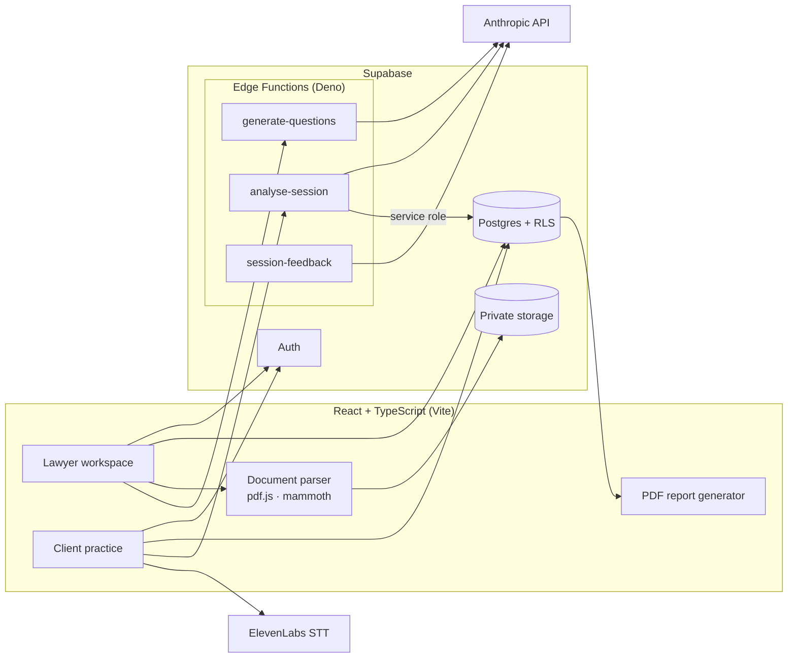
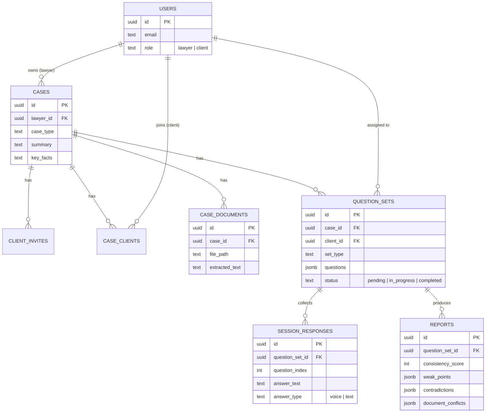

<div align="center">

# Prepd

**AI-assisted deposition and testimony preparation**

[](https://react.dev/)
[](https://www.typescriptlang.org/)
[](https://supabase.com/)
[](https://www.anthropic.com/)

[Demo Video](https://github.com/user-attachments/assets/b8179913-1d07-4671-9723-b0e625ce8a04) · [Architecture](#-architecture) · [Quick Start](#-quick-start) · [Data Model](#-data-model) · [Known Issues](#-known-issues)

</div>

https://github.com/user-attachments/assets/b8179913-1d07-4671-9723-b0e625ce8a04

---

## 🧠 Overview

Prepd lets a lawyer turn a case file into targeted practice questions, has the client answer them by voice or text, and returns a structured readiness report that flags contradictions, weak answers and conflicts with the documents before opposing counsel finds them.

> Find the contradiction before opposing counsel does.

### ✨ Why Prepd?

Preparing a client for a deposition is slow, manual work. A lawyer reads the file, writes questions, runs mock sessions in person and takes notes on where the client's account drifts. Most clients get one or two rehearsals, and the problems that matter, such as a date that contradicts an email or an answer that volunteers too much, surface late.

Prepd moves the repetition out of the lawyer's calendar:

| Conventional preparation | Prepd |
|---|---|
| Lawyer writes questions by hand | Questions generated from the case summary, key facts and uploaded documents |
| Rehearsal happens in billable meetings | Client practises on their own time, by voice or text |
| Notes depend on what the lawyer catches live | Every answer is stored and analysed against the others and the documents |
| Findings live in a legal pad | A structured report with risk levels, exportable as PDF |

---

## 🚀 Features

| Feature | Description |
|---|---|
| **Two separate experiences** | Lawyers manage cases, documents, clients and reports. Clients see only their own cases and practice sessions. Routes are role-protected in the app and rows are protected in the database. |
| **Case-grounded question generation** | Claude reads the case summary, key facts and extracted document text, then writes questions phrased as opposing counsel would ask them, ordered from easier to harder. |
| **Seven question-set types** | Background and timeline, relationships, credibility challenges, event-specific deep dive, document confrontation, hostile cross-examination and procedural familiarity. A client's first session is always an essential-foundation set. |
| **Voice or text answers** | Answers are recorded in the browser and transcribed with ElevenLabs speech-to-text, or typed directly. Each answer is saved with its type. |
| **Structured readiness report** | A consistency score from 1 to 10, strong points, weak points with risk levels, contradictions between answers, conflicts with documents, volunteered information and a recommended next set. |
| **PDF export** | Reports download as a branded PDF produced by a dependency-free generator written for this project. |
| **In-browser document parsing** | PDF, DOCX, TXT and Markdown files are parsed client-side before upload to private storage. |
| **Token-based client invites** | A lawyer invites a client by email; the client signs up through a tokenised link and is attached to the case. |

---

## 📐 Architecture



The frontend talks to Supabase directly through the JavaScript SDK, with row-level security deciding what each user can read or write. All calls to Claude go through edge functions, so the Anthropic key never reaches the browser. The report is written by the `analyse-session` function using the service role, because clients are not permitted to insert or read reports.

---

## 🧰 Tech Stack

<div align="center">

### Frontend


### Backend


### AI & APIs


### Document Processing


</div>

---

## 🏃 Quick Start

```bash
git clone https://github.com/summitkabir6/Prepd.git
cd Prepd
```

### Prerequisites

- Node.js 18 or newer
- A [Supabase](https://supabase.com) project and the Supabase CLI
- An Anthropic API key
- An ElevenLabs API key (needed for voice answers only)

### 1. Create the database

In the Supabase SQL Editor, run these files in order:

| Order | File | Purpose |
|---|---|---|
| 1 | `supabase/schema.sql` | Tables, row-level security, signup trigger, storage bucket |
| 2 | `supabase/fix-rls-recursion.sql` | Replaces recursive policies with `SECURITY DEFINER` helpers |
| 3 | `supabase/client-invite-rls.sql` | Invite accept and decline support |

### 2. Deploy the edge functions

```bash
supabase login
supabase link --project-ref YOUR_PROJECT_REF

supabase secrets set ANTHROPIC_API_KEY=your_anthropic_key
supabase secrets set SUPABASE_SERVICE_ROLE_KEY=your_service_role_key

supabase functions deploy generate-questions
supabase functions deploy analyse-session
supabase functions deploy session-feedback
```

### 3. Configure the frontend

Copy `.env.example` to `.env` and fill in the values:

| Variable | Purpose |
|---|---|
| `VITE_SUPABASE_URL` | Supabase project URL |
| `VITE_SUPABASE_ANON_KEY` | Supabase anon key |
| `VITE_ELEVENLABS_API_KEY` | ElevenLabs key for speech-to-text |

`.env` is git-ignored. Do not commit keys.

### 4. Run

```bash
npm install
npm run dev
```

The app is served on port 5173. `npm run build` type-checks and produces a production bundle.

### 5. Create a lawyer account

New signups default to the `client` role, so the first lawyer is promoted by hand. Invite the user from **Authentication > Users** in the Supabase dashboard, then run:

```sql
UPDATE public.users SET role = 'lawyer' WHERE email = 'lawyer@example.com';
```

---

## 🎯 Usage

1. **Sign in as the lawyer** and create a case with a name, type, summary and key facts.
2. **Upload documents.** Text is extracted in the browser and stored alongside the file.
3. **Invite a client.** This produces an `/invite/:token` link.
4. **Open the link as the client** to create an account and join the case.
5. **Assign a question set** from the case page. Generation takes a few seconds.
6. **Complete the session as the client**, answering by voice or text.
7. **Open the report as the lawyer** once analysis finishes, and export it as a PDF if needed.

| Route | Role | Page |
|---|---|---|
| `/login` | Public | Sign in |
| `/invite/:token` | Public | Accept an invite and sign up |
| `/dashboard` | Lawyer | Case list |
| `/cases/new` | Lawyer | Create a case |
| `/cases/:caseId` | Lawyer | Case detail: documents, clients, question sets |
| `/cases/:caseId/clients/:clientId/report/:reportId` | Lawyer | Readiness report |
| `/prepare` | Client | Cases and pending invites |
| `/prepare/case/:caseId` | Client | Case overview and assigned sessions |
| `/prepare/session/:questionSetId` | Client | Practice session |
| `/prepare/complete` | Client | Session complete |

---

## 🔬 How the Analysis Works

**1. Question generation.** `generate-questions` receives the case summary, key facts, concatenated document text, the client's name and the set type. The model is instructed to return a bare JSON array of questions that are specific to the case, grounded in the supplied facts and ordered by difficulty. The response is stripped of any code fences, parsed and validated as an array before it is stored.

**2. Session.** The client answers one question at a time. Each answer is written to `session_responses` as it is submitted. Submitting the final answer marks the set as completed and triggers analysis in the background.

**3. Analysis.** `analyse-session` makes two model calls:

| Pass | Input | Output |
|---|---|---|
| Structured analysis | Case context plus the full question-and-answer transcript | A JSON object with a fixed schema |
| Narrative report | The JSON from the first pass | A written report with section headings for the lawyer |

The first pass is prompted to be strict: a score of 8 or above should be rare, and every inconsistency, vague answer and piece of volunteered information should be flagged. Separating extraction from writing keeps the structured fields reliable for the interface while still giving the lawyer readable prose.

**4. Report.** The function inserts the result into `reports` with the service role and returns the report ID.

```jsonc
{
  "overall_assessment": "…",
  "consistency_score": 6,               // 1 to 10
  "strong_points": ["…"],
  "weak_points": [{ "question_refs": ["Q1"], "finding": "…", "risk_level": "High" }],
  "contradictions": [{ "question_a": "…", "answer_a": "…", "question_b": "…", "answer_b": "…", "description": "…" }],
  "document_conflicts": [{ "question_ref": "Q2", "client_answer": "…", "document_excerpt": "…", "description": "…" }],
  "volunteered_information": ["…"],
  "recommended_next_set": "…"
}
```

---

## 🗄 Data Model



---

## 🔐 Access Control

Row-level security is enabled on every table. The intent of the policies:

| Table | Lawyer | Client |
|---|---|---|
| `cases` | Full access to own cases | Read cases they have joined |
| `case_documents` | Full access for own cases | Read for joined cases |
| `case_clients` | Read and add for own cases | Read and create own membership |
| `client_invites` | Full access to own invites | Accept or decline invites sent to their email |
| `question_sets` | Read and create for own cases | Read and update own sets |
| `session_responses` | Read for own cases | Create and read own answers |
| `reports` | Read for own cases | No access |

Policies that reference each other across `cases` and `case_clients` caused infinite recursion in the original schema. `fix-rls-recursion.sql` resolves this with `SECURITY DEFINER` helper functions (`is_case_lawyer`, `is_case_client`, `is_qs_case_lawyer`) that perform the membership check outside the policy chain.

---

## 📡 Edge Function Reference

All three functions accept `POST` with a JSON body and are invoked through `supabase.functions.invoke`.

| Function | Request fields | Response |
|---|---|---|
| `generate-questions` | `case_summary`, `key_facts`, `all_document_text`, `set_type`, `client_name` | `{ questions: string[] }` |
| `analyse-session` | `question_set_id`, `case_id`, `client_id`, `case_summary`, `key_facts`, `all_document_text`, `set_type`, `questions_and_answers` | `{ success: true, report_id }` |
| `session-feedback` | `case_summary`, `key_facts`, `set_type`, `prior_qa`, `question`, `answer`, `question_number`, `total_questions`, `next_question` | `{ feedback: string }` |

`session-feedback` returns two to three sentences of coaching on a single answer. It is deployed and has a client helper in `src/lib/claude.ts`, but is not yet wired into the session screen.

---

## 📁 Project Structure

```
prepd/
├── src/
│   ├── pages/
│   │   ├── lawyer/            Dashboard, new case, case detail, report
│   │   ├── client/            Prepare, case view, session, complete
│   │   ├── Login.tsx
│   │   └── Invite.tsx
│   ├── components/
│   │   ├── lawyer/            Case form, document upload, invites, set assignment, report view
│   │   ├── client/            Question card, voice recorder, progress bar
│   │   ├── shared/            Layout, protected route
│   │   ├── prepd/             Brand components
│   │   └── ui/                Radix-based primitives
│   ├── lib/
│   │   ├── claude.ts          Edge function clients
│   │   ├── elevenlabs.ts      Speech-to-text
│   │   ├── documentParser.ts  PDF, DOCX and text extraction
│   │   ├── pdf.ts             PDF report generator
│   │   └── supabase.ts        Supabase client
│   ├── hooks/                 useAuth, useCase
│   └── types/                 Shared domain types
├── supabase/
│   ├── schema.sql
│   ├── fix-rls-recursion.sql
│   ├── client-invite-rls.sql
│   └── functions/
│       ├── generate-questions/
│       ├── analyse-session/
│       └── session-feedback/
└── docs/
    └── design-brief.md        Product and interface brief
```

---

## 🐛 Known Issues

Prepd is a hackathon prototype. It is not legal advice and has not been reviewed for use with real client matters.

- **Sets are short.** Each generated set contains three questions, sized for a live demo.
- **The ElevenLabs key is exposed to the browser.** It is read from a `VITE_` variable and sent directly from the client. A production build should proxy transcription through an edge function.
- **Storage and invite policies are permissive.** Any authenticated user can read objects in the `case-documents` bucket, and invite rows are readable without authentication so the invite page can load. Both need tightening before real documents are stored.
- **Edge functions trust their input.** They do not check that the caller belongs to the case named in the request, and CORS is open to all origins.
- **Document text is sent whole.** All extracted text is concatenated into the prompt with no chunking or retrieval, so very large case files will exceed the model's context window.
- **Model output is not verified.** Reports can contain errors or miss issues. They are a starting point for a lawyer's judgement, not a substitute for it.
- **No automated tests.**

---

## 📧 Contact

Summit Kabir · [@summitkabir6](https://github.com/summitkabir6)

Project link: [github.com/summitkabir6/Prepd](https://github.com/summitkabir6/Prepd)

---

<div align="center">
  <sub>Built for LexidenHack</sub>
</div>
